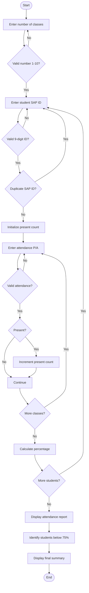

# Mini-Hackathon-
# Student Attendance Analyzer
## Problem 7 – C Programming Project
### 1. Project Overview

The **Student Attendance Analyzer** is a C-based program designed to record, calculate, and analyze the attendance of students across multiple classes.

The program accepts attendance as Present (P) or Absent (A), calculates the individual attendance percentage of each student, and identifies students whose attendance falls below the specified threshold of 75%.

The program also validates student SAP IDs to ensure that each student has a unique 9-digit SAP ID.

### 2. Team Details

| S. No. | Team Member Name |
|---|---|
| 1 | Yasharth Chaudhary |
| 2 | Mayra Bisht |
| 3 | Yashowardhan |

**Team Number:** [TEAM MAYAYA]  
**Batch:** [44]

### 3. Problem Statement

Develop a C program to record and analyze attendance for a class of students.

**Requirements:**

1. Store attendance for at least 10 students across multiple classes.
2. Record attendance as Present (P) or Absent (A).
3. Calculate each student's attendance percentage.
4. Identify students below a specified attendance threshold, such as 75%.

**Expected Output:** A student-wise attendance report and a list of students below the attendance threshold.

### 4. Objectives

The main objectives of this project are:

- To develop a student attendance management system using C.
- To record attendance for multiple students and classes.
- To validate attendance inputs and SAP IDs.
- To prevent duplicate SAP ID entries.
- To calculate individual attendance percentages accurately.
- To identify students with attendance below 75%.
- To understand the practical implementation of arrays, functions, loops, conditional statements, and string handling in C.

### 5. Features of the Program

**1. Fixed Student Capacity**

The program records attendance for 10 students.

**2. Multiple Class Attendance**

The user can enter the number of classes between 1 and 10.

**3. Attendance Input Validation**

The program accepts only P or A, regardless of uppercase or lowercase letters.

**4. SAP ID Validation**

Each SAP ID must contain exactly 9 numeric digits.

**5. Duplicate SAP ID Prevention**

The program uses string comparison to ensure that no two students have the same SAP ID.

**6. Automatic Attendance Calculation**

The program calculates the percentage of attendance for every student.

**7. Attendance Threshold Analysis**

Students with attendance below 75% are displayed separately.

**8. Student-Wise Report**

The program displays SAP IDs, attendance records, present classes, and attendance percentages.

### 6. Technologies Used

- Programming Language: C
- Compiler: GCC / Turbo C (where supported) / Code::Blocks
- Development Environment: Visual Studio Code or any C-supported IDE
- Version Control: Git and GitHub

### 7. C Programming Concepts Used

| Concept | Application in Project |
|---|---|
| Header Files | `stdio.h`, `string.h` |
| Macros | `#define` for fixed values |
| Variables | Store attendance and percentages |
| One-dimensional Arrays | Store present counts and percentages |
| Two-dimensional Arrays | Store attendance records |
| Strings | Store and validate SAP IDs |
| User-defined Functions | Separate input and validation tasks |
| For Loops | Iterate through students and classes |
| While Loops | Validate user inputs |
| Do-While Loops | Repeat SAP ID input when duplicated |
| If-Else Statements | Check attendance and input validity |
| String Functions | `strlen()` and `strcmp()` |
| Ternary Operator | Display P or A based on stored values |
| Logical Operators | Validate multiple conditions |

### 8. Algorithm

1. Start the program.
2. Define the number of students, maximum classes, and attendance threshold.
3. Ask the user to enter the number of classes.
4. Validate that the number of classes is between 1 and 10.
5. Repeat the following steps for 10 students:
   - Accept the student's 9-digit SAP ID.
   - Validate the SAP ID.
   - Check whether the SAP ID already exists.
   - If duplicated, request a different SAP ID.
   - Initialize the present count to zero.
   - Accept attendance for each class as P or A.
   - Validate each attendance entry.
   - Increase the present count whenever attendance is P.
   - Calculate the attendance percentage.
6. Display the attendance report for all students.
7. Compare every student's attendance percentage with the 75% threshold.
8. Display the students whose attendance is below 75%.
9. Display the total number of students below the threshold.
10. End the program.

### 9. Pseudocode

```text
START

DEFINE STUDENTS = 10
DEFINE MAX_CLASSES = 10
DEFINE THRESHOLD = 75

INPUT number_of_classes

VALIDATE number_of_classes

FOR each student from 0 to 9

    INPUT SAP_ID

    VALIDATE SAP_ID
    CHECK FOR DUPLICATE SAP_ID

    IF duplicate exists
        ASK FOR ANOTHER SAP_ID
    END IF

    SET present_count = 0

    FOR each class

        INPUT attendance (P/A)

        VALIDATE attendance

        IF attendance == P
            present_count = present_count + 1
        END IF

    END FOR

    CALCULATE attendance_percentage

END FOR

DISPLAY student-wise attendance report

SET below_threshold = 0

FOR each student

    IF attendance_percentage < THRESHOLD

        DISPLAY student SAP ID and percentage

        INCREMENT below_threshold

    END IF

END FOR

DISPLAY total students below threshold

STOP
```

### 10. Flowchart



### 11. Attendance Calculation Formula

The program calculates attendance using the following mathematical formula:

**Attendance Percentage = (Number of Present Classes / Total Number of Classes) × 100**

Example:

- Total classes = 10
- Present classes = 7
- Absent classes = 3

Calculation:

```text
Attendance = (7 / 10) × 100

Attendance Percentage = 70%
```

Since 70% is below the required threshold of 75%, the student is included in the list of students below the threshold.

### 12. Sample Test Cases

#### Test Case 1: Valid Attendance Input

**Input:**

- Number of classes: 2
- SAP ID: 590039724
- Attendance: P, P

**Expected Output:**

```text
SAP ID: 590039724
Attendance: P P
Present: 2/2
Percentage: 100.0%
```

**Actual Output:** The program displays the same result.

#### Test Case 2: Attendance Below Threshold

**Input:**

- Number of classes: 2
- SAP ID: 590039725
- Attendance: P, A

**Expected Output:**

```text
SAP ID: 590039725
Attendance: P A
Present: 1/2
Percentage: 50.0%
```

**Actual Output:** The student is displayed in the below-75% list.

#### Test Case 3: Duplicate SAP ID

**Input:**

```text
Student 1 SAP ID: 590039724
Student 2 SAP ID: 590039724
```

**Expected Output:**

```text
SAP ID already exists!
Enter a different SAP ID:
```

**Actual Output:** The program rejects the duplicate and requests another SAP ID.

#### Test Case 4: Invalid SAP ID

**Input:**

```text
12345AB89
```

**Expected Output:**

```text
Invalid SAP ID!
Enter exactly 9 digits:
```

**Actual Output:** The program rejects the invalid SAP ID and requests a valid one.

#### Test Case 5: Invalid Attendance Input

**Input:**

```text
X
```

**Expected Output:**

```text
Invalid! Enter only P or A:
```

**Actual Output:** The program rejects the invalid attendance entry.

#### Test Case 6: Invalid Number of Classes

**Input:**

```text
Enter number of classes: 15
```

**Expected Output:**

```text
Invalid! Enter number from 1 to 10:
```

**Actual Output:** The program rejects the value and asks for a valid number.

### 13. Compilation and Execution Instructions

**Step 1: Install a C compiler**

Install GCC or use an IDE that supports C programming.

**Step 2: Save the source code**

Save the program as:

```text
attendance.c
```

**Step 3: Open the terminal**

Navigate to the directory containing the source file.

**Step 4: Compile the program**

```bash
gcc attendance.c -o attendance
```

**Step 5: Execute the program**

For Windows:

```bash
attendance.exe
```

For Linux or macOS:

```bash
./attendance
```

### 14. Advantages

- Simple and user-friendly input system.
- Automatic attendance percentage calculation.
- Prevents duplicate SAP IDs.
- Validates incorrect user inputs.
- Provides a clear student-wise attendance report.
- Reduces manual calculation errors.

### 15. Limitations and Future Improvements

**Current Limitations:**

- The program supports only 10 students.
- The maximum number of classes is limited to 10.
- Student records are not permanently stored.
- The program does not provide a graphical user interface.

**Future Improvements:**

- Add file handling to save attendance records permanently.
- Allow a dynamic number of students.
- Include student names and additional information.
- Generate downloadable attendance reports.
- Develop a graphical user interface.
- Add search and update functionality for student records.

### 16. Conclusion

The Student Attendance Analyzer successfully demonstrates the implementation of fundamental C programming concepts in a practical application.

The project provides an organized method of recording student attendance, validating SAP IDs, calculating attendance percentages, and identifying students below the specified attendance threshold.

Through this project, the team gained practical experience in arrays, functions, loops, conditional statements, string handling, input validation, and logical problem-solving.

The project can be further developed into a complete student attendance management system by introducing file handling, dynamic storage, and a graphical user interface.

---

**Project:** Student Attendance Analyzer  
**Course:** C Programming  
**Team Members:** Yasharth Chaudhary, Mayra Bisht, Yashowardhan


